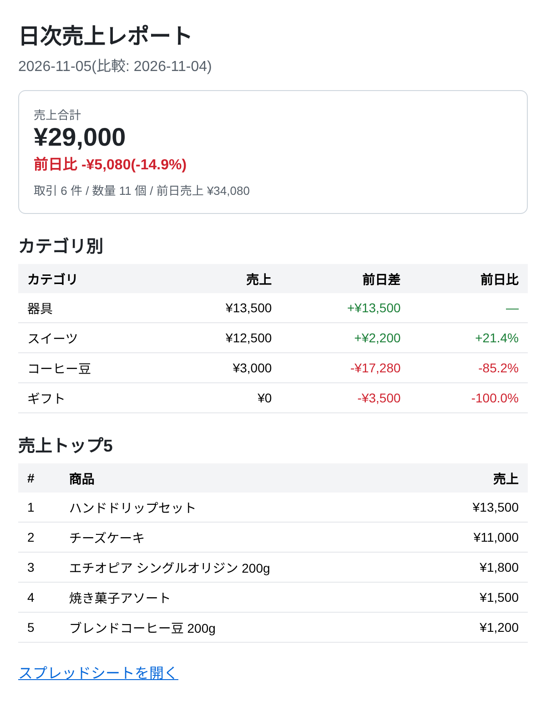

# 日次売上レポート自動送信ツール(Google Apps Script)

Googleスプレッドシートの売上データを**毎朝自動で集計し、前日比つきのレポートをメールで届ける**ツールです。

「毎朝スプレッドシートを開いて売上を集計し、上司やチームに報告する」という定型作業をなくすことを想定して作りました。プログラミングの知識がない方でも、スプレッドシートのメニューから操作できます。



## 主な機能

- 「売上」シートのデータを**前日分で自動集計**(売上合計・件数・数量)
- **前日比**(金額差・増減率)を計算し、増加は緑・減少は赤で色分け
- **カテゴリ別**の売上と前日比、**売上トップ5商品**を一覧表示
- **毎朝8時台に自動でメール送信**(トリガー設定もメニューから1クリック)
- 集計結果を「日次集計」シートに**履歴として蓄積**(同じ日を再実行しても重複しない)
- エラー時は**エラー通知メール**を送信し、実行ログにも記録
- 送信先・件名・0件の日の扱いは「設定」シートで変更でき、**コードを触らずに運用可能**

## 使い方

### 1. スクリプトを設置する

1. 新しいGoogleスプレッドシートを作成
2. メニューの「拡張機能」→「Apps Script」を開く
3. 最初からある `コード.gs` の中身をすべて消して、`src/Code.js` の内容を貼り付け
4. 左の「ファイル」の「+」→「スクリプト」で `Report` というファイルを作り、`src/Report.js` の内容を貼り付け
5. 左の「⚙ プロジェクトの設定」で「『appsscript.json』マニフェスト ファイルをエディタで表示する」にチェックを入れ、`appsscript.json` を `src/appsscript.json` の内容に置き換え(タイムゾーンを日本時間にするため)
6. 💾 で保存

### 2. 初期設定をする

1. スプレッドシートを再読み込みすると、メニューに「📊 売上レポート」が表示されます
2. 「① 初期設定」を実行(初回は Google の承認画面が出るので許可してください)
3. 「売上」「日次集計」「設定」の3シートが作られ、30日分のサンプル売上データが入ります

### 3. 動作を確認する

- 「② 今すぐレポートを送信(テスト)」で、昨日分のレポートが自分宛てに届きます

### 4. 自動送信をオンにする

- 「③ 毎朝8時の自動送信をオンにする」を実行すると、毎朝8時〜9時の間に前日分のレポートが送られます
- 止めたいときは「自動送信をオフにする」

## シートの構成

**売上**(1行目は見出し)

| 日付 | 商品名 | カテゴリ | 数量 | 単価 | 金額 |
|---|---|---|---|---|---|
| 2026-11-05 | ブレンドコーヒー豆 200g | コーヒー豆 | 2 | ¥1,200 | ¥2,400 |

※ 金額が空欄の場合は「数量 × 単価」で計算します。実データに差し替える場合は、この列の並びに合わせてください。

**設定**

| 項目 | 内容 |
|---|---|
| 送信先メールアドレス | 複数の場合はカンマ区切り |
| 件名の先頭 | 例:【日次売上レポート】 |
| 売上0件でも送信する | 「はい」で0件の日も送信 |

**日次集計**:日付・売上合計・前日売上・前日差・前日比・件数・数量・記録日時 が自動で追記されます。

## ファイル構成

```
gas-daily-sales-report/
├── src/
│   ├── Code.js            # メニュー・シート操作・メール送信・トリガー
│   ├── Report.js          # 集計・レポート生成ロジック(GAS非依存)
│   └── appsscript.json    # マニフェスト(タイムゾーン等)
├── tests/
│   └── report.test.js     # 集計ロジックのテスト
└── docs/
    └── email-sample.png
```

集計ロジック(`Report.js`)は Google のサービスに依存しない形に分けているため、ローカルの Node.js でテストできます。

## テスト

```bash
node --test
```

(Node.js 18 以上)

## 使用技術

Google Apps Script(V8)/ SpreadsheetApp / MailApp / 時間主導型トリガー / Node.js(テスト)

## 注意事項

- Gmail(無料アカウント)からの送信は1日100通程度の上限があります
- 時間主導型トリガーは「8時〜9時の間」のように1時間の幅で実行されます
